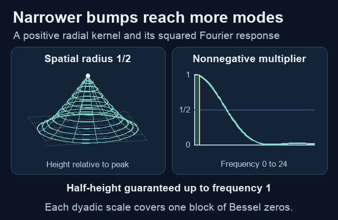

# An endpoint converse for order-zero Bessel–Fourier coefficients

For every nonnegative sequence $a_m\to0$, there is a nonnegative $f\in L^1([0,1],x\,dx)$ supported in $[0,1/2]$ whose normalized order-zero coefficients satisfy **$a_m\le f_m/\sqrt{j_m}\to0$**. This proves Acosta Babb’s endpoint existence statement without the modified Fejér positivity premise. Separate earlier works refute that premise. [Endpoint statement and parity question](https://wrap.warwick.ac.uk/id/eprint/199656/1/1-s2.0-S0022247X26000521-main.pdf#page=13)

[Paper PDF](paper/manuscript.pdf) · [LaTeX source](paper/manuscript.tex) · [Proof outline](proof/PROBLEM_AND_PROOF.md)

## From spatial scales to frequency blocks

The proof uses autocorrelations to keep all frequency contributions nonnegative. A weighted sum of dilates covers successive Bessel zero blocks, and two geometric tails enforce normalized convergence. The diagram uses an explicit disk overlap to show the scaling.

[Download the offline explorer ZIP](https://raw.githubusercontent.com/DannyExperiments/endpoint-bessel-fourier-coefficients/v1.0.0/visualization/endpoint-bessel-fourier-coefficients-explorer.zip) · [Worked example](visualization/README.md)

## Scope and evidence

A separate Dirichlet heat argument rules out the proposed one-parity strengthening. It concerns the prescribed positive lower bounds. The general question of unregularized divergence remains separate. [Claim scope](CLAIM_SCOPE_AND_LIMITATIONS.md) · [Literature audit](audits/public_safe_reports/LITERATURE_AUDIT.md)

The Python replay checks exact dyadic algebra and numerical illustration controls. Partial Lean checks the dyadic exponent identities and auxiliary comparisons. Internally reviewed, not peer reviewed. [Reproducibility](REPRODUCIBILITY.md) · [Technical disclosure](AI_DISCLOSURE.md)

DannyExperiments is the preferred citation identity. [Release v1.0.0](https://github.com/DannyExperiments/endpoint-bessel-fourier-coefficients/releases/tag/v1.0.0) · [Version DOI](https://doi.org/10.5281/zenodo.24572923) · [Citation metadata](CITATION.cff)
